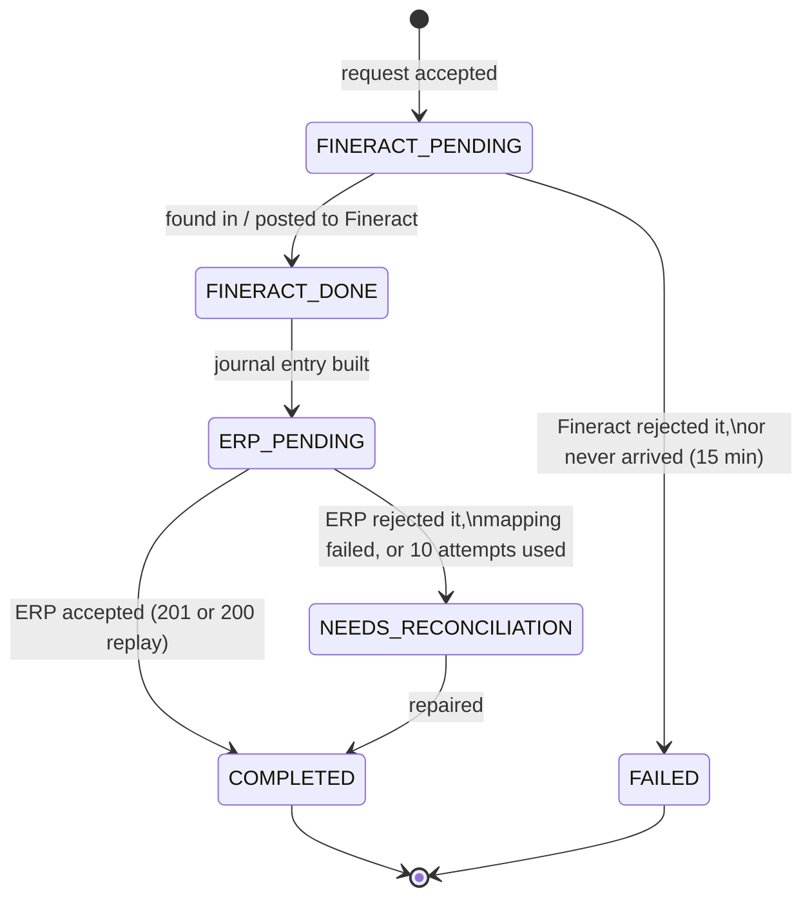

# Architecture

This page explains how the pieces fit together and how data moves between them. The reasons behind each choice are in [DECISIONS.md](DECISIONS.md).

## Components

```
                       X-API-Key, X-Correlation-ID
  Partner / teller app ─────────────────────────────┐
                                                    ▼
                                    ┌──────────────────────────────┐
                                    │      Integration Service     │
                                    │  FastAPI, port 8080          │
                                    │                              │
                                    │  API: clients, loans,        │
                                    │       transactions, GL sync, │
                                    │       reconciliation, admin  │
                                    │  background loop (every 5 s):│
                                    │       GL sync retries,       │
                                    │       transaction recovery   │
                                    └───────┬──────────────┬───────┘
                       HTTPS, Basic auth    │              │  HTTP
                       (least-privilege     │              │
                        API user)           ▼              ▼
                    ┌────────────────────────────┐   ┌──────────────────────┐
                    │  Fineract 1.15.0 + patch   │   │      Mock ERP        │
                    │  port 8443                 │   │  FastAPI, port 8081  │
                    │  clients, loans, GL        │   │  chart of accounts,  │
                    │  POST /glaccounts/sync     │   │  journal entries,    │
                    │  (new)                     │   │  balances            │
                    └─────────────┬──────────────┘   └──────────┬───────────┘
                                  │                             │
                    ┌─────────────▼─────────────────────────────▼───────────┐
                    │ PostgreSQL 18.3: fineract_tenants, fineract_default,  │
                    │                  integration, erp                     │
                    └───────────────────────────────────────────────────────┘
```

All four databases live in one Postgres container to keep the local setup small. Each service has its own database and its own DB user, and no service reads another service's tables. The integration service only talks to Fineract and the ERP over HTTP.

| Component | What it owns |
|---|---|
| **Mock ERP** | The chart of accounts and the journal. It's the accounting master. |
| **Fineract** | Clients, loans, repayment schedules, balances, and the loan transactions themselves. It's the system of record for money owed. |
| **Integration Service** | The business identifiers (`client_uid`, `loan_reference`), the mapping to Fineract IDs, the idempotency records, and the state of every transaction as it moves from Fineract to the ERP. |

## Identifiers

Callers never see or send a Fineract ID. Everything is addressed by business identifiers:

| Identifier | Example | Who issues it | Stored in Fineract as |
|---|---|---|---|
| `client_uid` | `SME-000001` | the caller | client `externalId` |
| `loan_reference` | `LN-2026-000001` | the integration service | loan `externalId` |
| `external_reference` | `FIN-2026-000001` | the caller, one per business operation | loan transaction `externalId` (disbursements and repayments) |
| GL `external_reference` | `GL-1200` | the ERP | GL account `external_id` (new column from the patch) |

Putting our references into Fineract's `externalId` fields matters for recovery. If we don't know whether a call reached Fineract, we can ask Fineract by reference instead of guessing.

## Data flow

### 1. GL accounts: ERP → Fineract

The ERP owns the chart of accounts. Fineract has to have the same GL accounts before the loan product can point at them.

```
POST /api/accounts/sync {external_reference: "GL-1200"}     (or /sync/all)
  │
  ├─ read the account from the ERP (GET /api/accounts)
  ├─ insert/find gl_account_sync row            status SYNC_PENDING
  ├─ lock the row (SELECT … FOR UPDATE)
  ├─ map ERP type → Fineract GL type            app/gl_mapping.py
  └─ POST /glaccounts/sync to Fineract
        ├─ 200            → SYNCED (Fineract id saved, never returned)
        ├─ 5xx / timeout  → stays SYNC_PENDING, next_attempt_at = backoff
        └─ 4xx / 409      → FAILED with the reason
```

The trigger is an explicit call. `make setup` calls `/sync/all` before creating the loan product, which is what keeps the order right: GL accounts first, then the product that uses them. Anything left in `SYNC_PENDING` is picked up by the background loop when its `next_attempt_at` comes round, using `FOR UPDATE SKIP LOCKED` so two workers never take the same row.

Sync is create-only, as the brief says. Renaming or deleting an account in the ERP doesn't flow through.

**Inside Fineract (the Java patch).** The new endpoint goes through Fineract's normal command pipeline, like every other write:

```
POST /glaccounts/sync
  → GLAccountsApiResource.syncGLAccount
  → CommandWrapperBuilder.syncGLAccount()        entity GLACCOUNT, action SYNC
  → PortfolioCommandSourceWritePlatformService   checks the SYNC_GLACCOUNT permission
  → SyncGLAccountCommandHandler (@Transactional)
  → GLAccountWritePlatformServiceJpaRepositoryImpl.syncGLAccount
        find by external_id
          found, same payload      → return the existing account
          found, different payload → GLAccountExternalIdConflictException → 409
          not found                → check glCode is free, create with external_id
        unique constraint hit by a concurrent request
                                   → ConcurrencyFailureException
                                     (Fineract's command retry runs it again, and
                                      the second time it finds the row)
```

The schema change is one Liquibase changelog (`0242_add_gl_account_external_id.xml`). It adds `acc_gl_account.external_id VARCHAR(100)` with a unique constraint and inserts the `SYNC_GLACCOUNT` permission.

### 2. Clients and loans

```
POST /api/clients      → Fineract POST /clients (externalId = client_uid)    → clients row
POST /api/loans        → reserve LN-YYYY-NNNNNN locally, then
                         Fineract POST /loans (externalId = loan_reference)   → loans row
POST /api/loans/{ref}/approve → Fineract approve                              → loans.approval_reference
```

Before creating anything, the service looks in Fineract by `externalId`. If an earlier attempt created the client or loan and then the response got lost, the service adopts that record and doesn't create a second one.

`GET /api/clients/{client_uid}` and `GET /api/loans/{loan_reference}` always read the current state from Fineract (status, balances, schedule). The local tables only hold the mapping, never a copy of the balances.

### 3. Money movements: Fineract first, then the ERP

Disbursements and repayments are the important part. Each one becomes a row in `loan_transactions`, and that row walks through a state machine:

```
POST /api/loans/{ref}/repayments {external_reference: "FIN-2026-000001", amount: 450000}
  │
  ├─ idempotency check (operation + external_reference + payload hash)
  ├─ insert loan_transactions row                         FINERACT_PENDING
  │
  ├─ take the per-loan advisory lock
  │    ├─ look up FIN-2026-000001 in Fineract by externalId
  │    ├─ not there → POST the repayment (externalId = FIN-2026-000001)
  │    └─ read the transaction back: id, amount, principal/interest/fee/
  │       penalty/overpayment portions                    FINERACT_DONE
  │  release the lock
  │
  ├─ build the journal entry from Fineract's portions     ERP_PENDING
  ├─ POST /api/journal-entries to the ERP (external_reference = FIN-2026-000001)
  │    ├─ 201/200 → save erp_transaction_id               COMPLETED   → caller gets 201
  │    ├─ down    → backoff, retried by the loop          ERP_PENDING → caller gets 202
  │    └─ 4xx     → stop                                  NEEDS_RECONCILIATION
  ▼
GET /api/transactions/FIN-2026-000001 shows where it is at any time
```

Fineract goes first because it's the system of record for the loan. If Fineract says no (loan not active, amount too large), nothing is posted anywhere and the caller gets a 422. Once Fineract has accepted the money, it has happened, so the only job left is getting the ERP to agree. That job can always be retried safely, because the ERP deduplicates on `external_reference`.

The journal entry is built from **Fineract's** breakdown of the transaction, never from our own interest maths (`app/accounting.py`, a pure function):

| Transaction | Debit | Credit |
|---|---|---|
| Disbursement | 1200 Loan Receivable | 1100 Bank |
| Repayment | 1100 Bank (full amount) | 1200 Loan Receivable (principal), 4000 Interest Income (interest), 4100 Fee Income (fees), 4200 Penalty Income (penalties), 2100 Overpayment Liability (overpayment) |

Zero lines are dropped. If the portions don't add up to the amount, or one is negative, the mapping refuses and the transaction goes to `NEEDS_RECONCILIATION`. A wrong entry is worse than a missing one.

### 4. Reconciliation: reads both sides

```
POST /api/reconciliation {from_date, to_date} and/or {loan_references | external_references}
  ├─ Fineract: loan transactions for our loans (disbursements, repayments, reversals)
  ├─ ERP:      journal entries for the same range, plus targeted lookups by reference
  └─ match one Fineract transaction ↔ one journal entry by external_reference
       MATCHED | MISSING_IN_ERP | MISSING_IN_FINERACT | AMOUNT_MISMATCH
       (plus TYPE_MISMATCH, SPLIT_MISMATCH for extra detail)
```

It's read-only. Repairs are a separate call (`POST /api/reconciliation/repairs`) for one reference at a time. Only two cases can be repaired automatically: something Fineract has that the ERP is missing, and a Fineract reversal that needs a `REV-` mirror entry in the ERP. Both are idempotent, so running a repair twice changes nothing the second time.

## State machine



| From | Allowed to | When |
|---|---|---|
| `FINERACT_PENDING` | `FINERACT_DONE` | Fineract has the transaction (we posted it, or found it by `externalId`) |
| | `FAILED` | Fineract rejected it with a 4xx, or the recovery sweep still can't find it 15 minutes later |
| `FINERACT_DONE` | `ERP_PENDING` | always, right away |
| `ERP_PENDING` | `COMPLETED` | the ERP returned 201, or 200 for a replay of the same entry |
| | `NEEDS_RECONCILIATION` | the ERP returned a 4xx, the mapping failed, or 10 attempts were used up |
| `NEEDS_RECONCILIATION` | `COMPLETED` | a reconciliation repair posted the entry |
| `COMPLETED`, `FAILED` | nothing | terminal |

The table lives in `app/state_machine.py` as `ALLOWED_TRANSITIONS`. Every status change goes through `transition()`, which raises on anything not in the table and writes a `transaction_status_changed` log line. The brief's example starts with `RECEIVED`. I merged it into `FINERACT_PENDING` because the row is only written right before the Fineract call, so the two states would always be the same.

**What's safe to retry:**

| Step | Safe to retry? | Why |
|---|---|---|
| Fineract call | Only after a lookup | We look up our `externalId` first. If it's there, we never send again. Fineract also rejects a duplicate `externalId` on its own. |
| ERP call | Yes, always | The ERP is idempotent on `external_reference`: same payload gives 200, a different one gives 409. |
| Recovery sweep | It never re-sends to Fineract | It only looks up. If the transaction isn't in Fineract, it waits, and after 15 minutes marks it `FAILED`. |

**Retry policy** (`app/retry.py`): exponential backoff starting at 2 s, doubling, capped at 60 s, at most 10 ERP attempts. The waits add up to about 5 minutes (2+4+8+16+32+60+60+60+60 s) before a person has to look at it. GL sync uses the same backoff.

### Recovery

The background loop runs once at startup and then every 5 seconds. It's the same code as `POST /api/admin/recovery`:

| Found in | What the sweep does |
|---|---|
| `FINERACT_PENDING` | look up the reference in Fineract. Found → carry on to the ERP. Not found → leave it, or `FAILED` after 15 minutes. |
| `FINERACT_DONE` | post to the ERP |
| `ERP_PENDING` with `next_attempt_at` due | post to the ERP again |

This covers a crash at any point. Every step commits its new state before the next network call, so after a restart the row says exactly where it stopped.

## Concurrency

A few layers stop money from moving twice. Each one covers a gap in the one before it:

1. **Idempotency records.** `(operation, external_reference)` is unique in `idempotency_records`. The first request inserts the row `IN_PROGRESS`. A duplicate either waits (gets 202 while the first is still running), gets the stored response replayed, or gets a 409 if the payload is different. If a request dies and leaves the row `IN_PROGRESS`, another request can take it over after 60 seconds.
2. **Constraints in the integration DB.** `loan_transactions.external_reference` is unique. A partial unique index, `one_active_disbursement_per_loan`, allows only one non-failed disbursement per loan, so ten disbursements with ten *different* references still give one row.
3. **Per-loan advisory lock.** `pg_advisory_lock(1, loan_id)` around the Fineract call, so only one write per loan reaches Fineract at a time. Without it, Fineract 1.15 answers concurrent repayments on the same loan with a 409 "loan is locked". The lock wait times out after 30 s and the caller gets 503 `LOAN_BUSY`.
4. **Fineract `externalId`.** The transaction reference is unique in Fineract too, and we look it up before every send.
5. **Fineract loan state.** The last line of defence. A loan that's already active can't be disbursed again. Fineract refuses whatever our service does.

On the ERP side, `journal_entries.external_reference` is unique and each entry carries a hash of its payload. The ERP doesn't rely on the caller to deduplicate.

## Data model

### Integration service (`integration` database)

| Table | Key columns | Constraints |
|---|---|---|
| `gl_account_sync` | `external_reference`, `erp_code`, `erp_type`, `status`, `fineract_gl_account_id`, `attempts`, `next_attempt_at`, `last_error` | `external_reference` unique |
| `idempotency_records` | `operation`, `external_reference`, `request_hash`, `status`, `response_status`, `response_body` | unique (`operation`, `external_reference`) |
| `clients` | `client_uid`, `external_reference`, `name`, `fineract_client_id` | all three identifiers unique |
| `loans` | `loan_reference`, `external_reference`, `client_id`, `principal`, `fineract_loan_id`, `approval_reference` | `loan_reference`, `external_reference`, `fineract_loan_id`, `approval_reference` unique |
| `loan_transactions` | `external_reference`, `loan_id`, `type`, `amount`, `transaction_date`, `status`, `fineract_transaction_id`, the five portions, `erp_transaction_id`, `erp_attempts`, `next_attempt_at`, `last_error` | `external_reference` unique; `one_active_disbursement_per_loan` partial unique index |

Money is stored as whole numbers (`BIGINT`) because RWF has no minor unit. If Fineract ever returns a decimal amount, the service refuses it instead of rounding.

### Mock ERP (`erp` database)

| Table | Key columns | Constraints |
|---|---|---|
| `accounts` | `code`, `name`, `type`, `currency`, `external_reference` | `code` and `external_reference` unique |
| `journal_entries` | `external_reference`, `entry_date`, `currency`, `loan_reference`, `transaction_type`, `total_amount`, `payload_hash` | `external_reference` unique, `total_amount > 0` |
| `journal_lines` | `entry_id`, `line_number`, `account_id`, `debit`, `credit` | no negatives, exactly one side per line |

The ERP checks that debits equal credits, that every account exists, and that every account's currency matches the entry's before it writes anything. On startup it seeds ten accounts (`GL-1100` … `GL-5200`). The loan product's accounting mapping is in `fineract/configuration/cash-accounting-mapping.json`.

### Fineract

The patch adds one column: `acc_gl_account.external_id`, unique. Everything else is stock Fineract. Clients, loans and loan transactions already have an `external_id` column, and we use those as they are.

## Cross-cutting

- **Auth.** `X-API-Key` on every `/api/*` route, with a separate admin key for `/api/admin/*`. Fineract is called as `integration_service`, a user whose role only has the permissions in `fineract/configuration/integration-service-permissions.json`.
- **Errors.** One shape everywhere: `{"error": {"code", "message", "correlation_id"}}`. The codes are listed in [API.md](API.md).
- **Correlation ID.** Taken from `X-Correlation-ID`, or generated if it's missing. It's echoed on the response, bound to every log line, and forwarded to Fineract and the ERP, so one ID follows a request through all three services. Recovery passes use their own `recovery-<uuid>` ID.
- **Logs.** JSON lines from both Python services, carrying `correlation_id`, `external_reference`, `client_uid`, `loan_reference`, `fineract_transaction_id`, `erp_transaction_id`, `status` and `timestamp` wherever they apply.
- **Fault injection.** `POST /api/admin/faults` makes the HTTP client fail a chosen call to Fineract or the ERP: fail before sending, time out after sending, or kill the process after sending. It's switched on by `FAULT_INJECTION_ENABLED` and is what the Part J simulations use.
